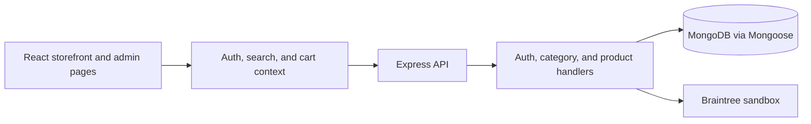

# E-Shopping

**A full-stack commerce project that connects a product catalog, customer accounts, and order workflows.**

The repository contains a React storefront and an Express API backed by MongoDB. It includes product and category management, user/admin routes, cart state, and a Braintree sandbox payment integration.

[Setup](#setup) · [Configuration](#configuration) · [Architecture](#architecture) · [Attribution](#attribution-and-license)

## Why this project

An online store connects several concerns that are useful to learn together: product data, authentication, search and filtering, carts, checkout, and administration. This project provides a concrete example of how a React client and a REST API share those responsibilities.

## Included workflows

- Product listing, search, filters, category browsing, and related products.
- Registration, login, profile updates, and password-recovery handlers.
- Admin interfaces for categories, products, and orders.
- Client-side authentication, search, and cart contexts.
- Order records and payment requests through Braintree's sandbox environment.

## Setup

Download and extract the repository. Use Node.js, npm, and a MongoDB database that you control.

Install the server and client dependencies from the repository root:

```bash
npm install
npm install --prefix client
```

Set up the server configuration described below, then start both applications:

```bash
npm run dev
```

The API defaults to port `8000`; the Create React App client normally uses `3000` and proxies API requests to `http://localhost:8000`.

For a built frontend served by Express:

```bash
npm run build --prefix client
npm start
```

## Configuration

The server loads environment variables through `dotenv`. Use your own values and keep credentials out of commits.

| Variable | Used for |
| --- | --- |
| `MONGO_URL` | MongoDB connection |
| `JWT_SECRET` | Authentication token signing and verification |
| `PORT` | API listen port |
| `DEV_MODE` | Startup log mode label |
| `BRAINTREE_MERCHANT_ID` | Sandbox merchant configuration |
| `BRAINTREE_PUBLIC_KEY` | Sandbox gateway configuration |
| `BRAINTREE_PRIVATE_KEY` | Sandbox gateway authentication |

The gateway is explicitly configured for Braintree Sandbox. Checkout needs compatible sandbox credentials and is not a live-payment deployment.

## Example workflow

1. Configure your development database and authentication secret.
2. Run the client and server, then create an account.
3. Populate products and categories through an appropriately configured admin account.
4. Browse products, add items to the cart, and exercise checkout with Braintree sandbox data.

## Architecture



The API groups routes under `/api/v1/auth`, `/api/v1/category`, and `/api/v1/product`. Express can also serve the compiled React client from `client/build/`.

## Source guide

| Path | Purpose |
| --- | --- |
| [client/src](client/src) | Storefront, admin screens, and client state |
| [server.js](server.js) | Server setup and route mounting |
| [routes](routes) | REST route definitions |
| [controllers](controllers) | Request handling and payment integration |
| [models](models) | Mongoose data models |
| [middlewares](middlewares) | Authentication and role checks |
| [config/db.js](config/db.js) | Database connection |

## Current scope

Treat this as a learning application. Review validation, authorization, secret management, and payment behavior before using real accounts or transactions. The repository includes committed environment files; configure your own development values instead of relying on those copies.

## Attribution and license

The root package metadata credits **Techinfoyt** and declares **MIT**. Preserve the original attribution when adapting the project; no separate root license file is present in the current tree.
